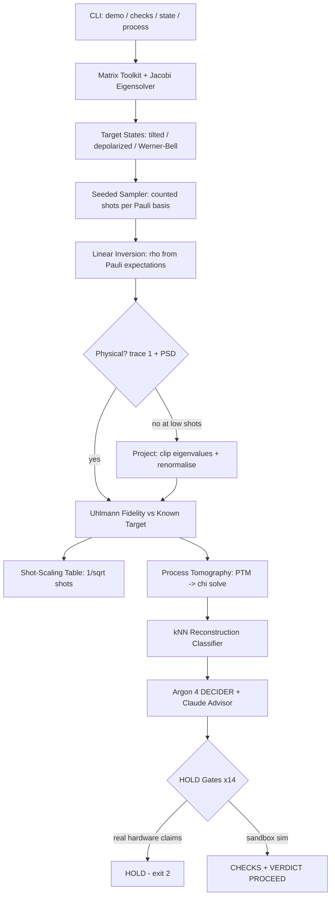
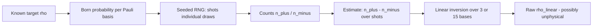
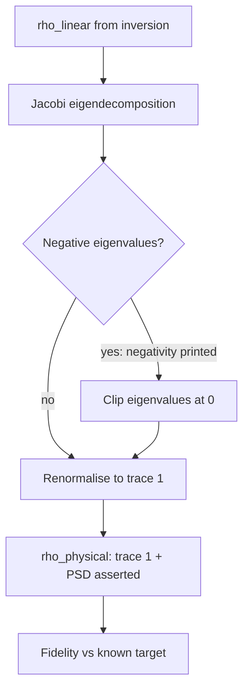
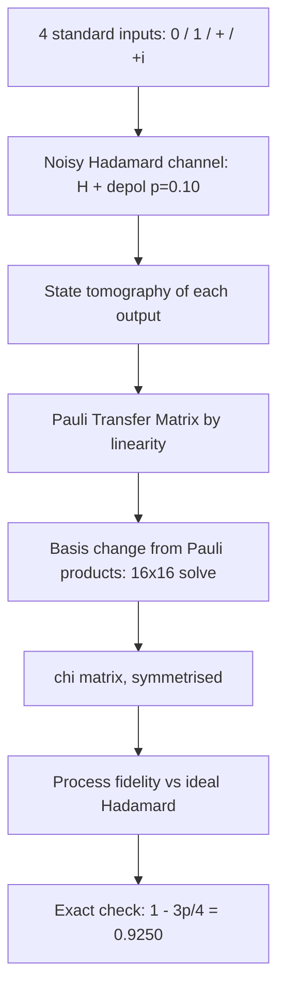
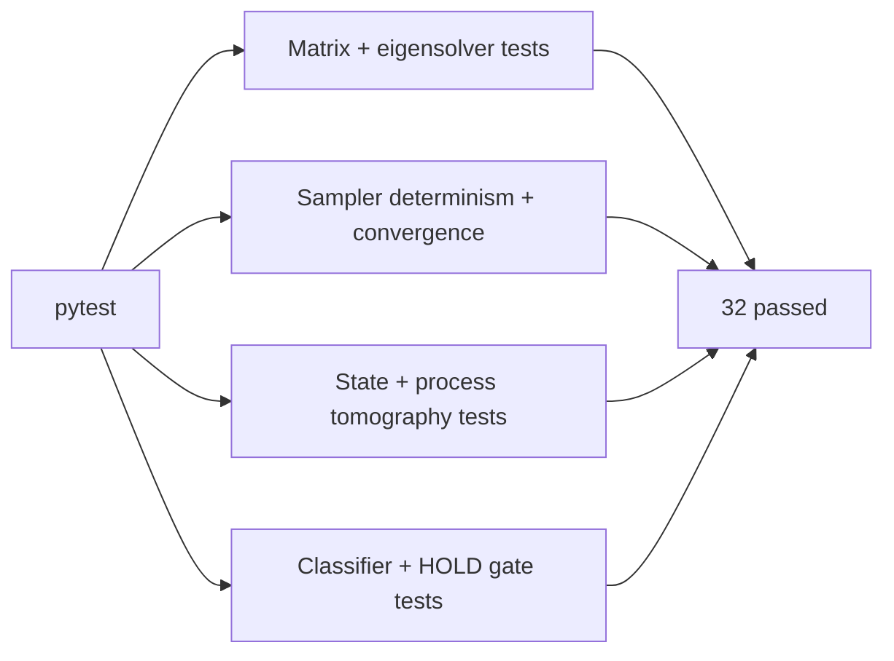
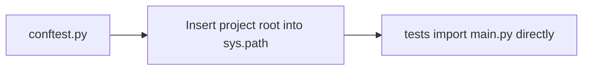
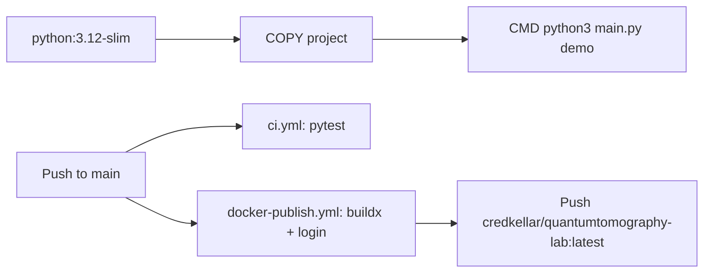

# QuantumTomography-Lab 🔬⚛️

**Quantum State & Process Tomography Lab** — by Darion Kellar

QuantumTomography-Lab is an **educational quantum tomography lab** in ONE pure-Python file. It prepares quantum states it knows exactly, "measures" them with a **seeded shot-by-shot sampler** in the Pauli basis, rebuilds the density matrix by **linear inversion**, watches the inversion **go unphysical at low shot counts**, projects it back to the nearest physical state, and only then quotes a **fidelity** — against the known target. It then does **process tomography lite**: one noisy gate (a Hadamard with a labelled depolarizing rate) is reconstructed into its **χ matrix**, solved from the Pauli transfer matrix of four tomographed outputs. Every piece of linear algebra — complex matrix ops, Kronecker products, a **Jacobi eigensolver**, PSD projection, Uhlmann fidelity — is written from scratch. No numpy.

The honest scope is the whole point, and it is stated everywhere:

- ✅ **What it teaches:** how tomography actually works — counted shots, inversion, physicality repair, shot-noise scaling, and χ reconstruction — with every step reproducible from a printed seed.
- 🚫 **What it can never do:** characterise real quantum hardware. The states are **self-prepared and already known**; tomography of a state you already know is a teaching exercise, not a measurement of any device. No benchmark, error rate, or verification claim about real systems can come out of this lab.

Every real-hardware characterisation, certified benchmarking, and production verification use sits behind a permanent HOLD gate (14 total). 🔒

[](https://github.com/kimanicollier44-cmyk/QuantumTomography-Lab/actions/workflows/ci.yml)
[](https://github.com/kimanicollier44-cmyk/QuantumTomography-Lab/actions/workflows/docker-publish.yml)

> ℹ️ These are the **live** workflow badges for this repo. They activate as soon as the `ci.yml` and `docker-publish.yml` files from the paste pack are pasted into `.github/workflows/` — until then they have nothing to report yet.

## 🧰 Tech Stack Badges & Full Architecture Tech Stack

### 💻 Core Programming Languages & Core Systems


- 🐍 Python 3.12, pure standard library (`math`, `cmath`, `random`, `hashlib`, `json`, `sys`) — zero dependencies, zero network, deterministic (double-run byte-identical)
- 🧮 Complex matrix toolkit written from scratch: products, dagger, Kronecker, trace — no numpy anywhere, so every number can be read and diffed
- 🔷 Jacobi eigensolver for Hermitian matrices (phase rotation + real Jacobi rotation, cyclic sweeps), proven in CHECKS by rebuilding V Λ V† to < 1e-9 on a random 4×4 Hermitian matrix
- 🎲 Seeded sampler: a "measurement" is `shots` individual counted Bernoulli draws against the Born probability — the estimate is always `(n_plus − n_minus) / shots`, never a probability dressed up as data
- 🧠 TinyML kNN reconstruction classifier (from scratch, stdlib): trustworthy / shaky / unreliable from (shots, fidelity, negativity before fix), labels generated by the lab's own quality model
- 🪑 Council seats: Gemini Argon 4 DECIDER (names-only, tighten-only) + Muse advisor (never overrides HOLD) + Google Flow plan-only (rendered = False, live = 0)

### ⛓️ Web3 & Infrastructure

- 🚫 **Not applicable — honestly.** No blockchain, no Web3, no tokens: the "infrastructure" here is one offline Python file, a seeded random number generator, and arithmetic. No fake badges here.

### ⚙️ Platform Support & Hardware Architecture


- 🖥️ Pure Python — runs anywhere Python 3.12+ runs (Linux, macOS, Windows), plus the `python:3.12-slim` Docker image
- 🔒 No quantum hardware is touched, ever: real-device characterisation, calibration, and acceptance testing are permanent HOLD gates (see the gate table below)

### ⚡ Low-Level Infrastructure & Performance

- 🚫 **No low-level code — honestly.** No C, no C++, no GPU, no compiled extensions: this is one interpreted Python file on purpose, so every eigenvalue, count, and χ entry can be read, checked, and diffed. Performance here means honest algorithms — a cyclic Jacobi eigensolver, a 16×16 complex linear solve for χ, and per-shot counting that costs exactly what the shot budget says it costs.

### 🛠️ DevOps & Build Tools


- 🐳 Docker (`python:3.12-slim`), GitHub Actions CI + Docker Publish (delivered in the paste pack)
- 🎯 Target image: `credkellar/quantumtomography-lab:latest`
- 🧪 Tests: `pytest` (32 tests) + the built-in CHECKS suite (50 checks) in `main.py`

### ☁️ Cloud Providers

- 🚫 **None — honestly.** No cloud provider is used or needed: the lab runs fully offline on your own machine or in a local Docker container. Docker Hub appears only as the registry the publish workflow pushes the image to.

## What this does?

1. 🧮 **A matrix toolkit with nothing hidden** — complex matrices as lists of lists: multiplication, dagger, Kronecker products for two qubits, traces, Hermitian parts. Pauli algebra is asserted, not assumed: `XY = iZ`, every Pauli squares to the identity, and the 2-qubit operators come out 4×4 by construction.
2. 🔷 **A Jacobi eigensolver, proven** — Hermitian eigen-decomposition by cyclic Jacobi sweeps (a phase rotation makes the target entry real, a real rotation annihilates it). CHECKS rebuild V Λ V† from the returned spectrum and demand agreement < 1e-9 — the solver grades itself before anything trusts it.
3. 🎯 **Known target states** — a tilted pure state (θ = 1.05, φ = 0.65, on the boundary of state space), a depolarized |+⟩ (labelled p = 0.25), and a Werner-Bell pair (0.85 Bell + 0.15 white noise). Each is verified to be a true density matrix: Hermitian, trace 1, no negative eigenvalues.
4. 🎲 **Measurements that are counts** — for each Pauli basis, the sampler makes `shots` individual draws and reports `(n_plus − n_minus) / shots`. Same seed, same counts, byte-identical rerun — CHECKS pin the determinism and the convergence to the Born rule at 100,000 shots.
5. 🔄 **Linear inversion** — the density matrix is rebuilt as ρ = (1/2ⁿ) Σ ⟨P⟩ P over 3 Pauli bases (1 qubit) or all **15 non-identity bases** (2 qubits). Fed the *exact* expectations, the inversion returns the target to < 1e-12 — the machinery is exact; only the shots are noisy.
6. 🕳️ **The unphysical dip, shown on purpose** — at **100 shots** per basis the tilted pure state inverts to a matrix with **negativity 0.0467**: negative eigenvalue mass, not a state at all. Pure states live on the boundary of the state space, so shot noise pushes the raw inversion outside it. The lab prints the broken intermediate instead of hiding it.
7. 🩹 **The physicality fix** — eigendecompose, clip the negative eigenvalues to zero, renormalise to trace 1. After the fix, every reconstruction in the lab is asserted trace-1, Hermitian, and PSD. The repaired 100-shot state scores fidelity **0.9821**; the 100,000-shot run scores **0.997258** — high-shot beats low-shot, in CHECKS, not in prose.
8. 📉 **The 1/√shots law, measured** — Bloch-vector error at 100 / 1k / 10k / 100k shots: **0.1300 → 0.0347 → 0.0038 → 0.0065**. Ten times the shots buys roughly √10 ≈ 3.16× less error, with honest fluctuation around the law (the last step is a slightly unlucky draw, printed as-is). There is no way around the square root; there is only buying shots.
9. 🌀 **Process tomography lite** — the gate is a Hadamard followed by depolarizing noise at a **labelled** p = 0.10. Four standard inputs (|0⟩, |1⟩, |+⟩, |+i⟩) are tomographed at the output (20,000 shots per basis), the Pauli transfer matrix is assembled by linearity, and χ is **solved** by inverting a fixed 16×16 basis change built from Pauli products. Result: χ trace **1.0000**, sampled process fidelity **0.9217** against the exact **0.9250** — which is 1 − 3p/4, not 1 − p, because the fully depolarizing χ = I/4 still overlaps the ideal gate by 1/4. Average gate fidelity: **0.9478**.
10. 🏷️ **Classifier + seats + checks** — a from-scratch kNN labels reconstructions trustworthy / shaky / unreliable with labels generated by the lab's own quality model (100-shot tilted: **shaky**; 100k tilted and the Bell pair: **trustworthy**; a starved 40-shot synthetic: **unreliable**), watched over by the Argon 4 DECIDER (sha256 trace), Muse advisor, Google Flow plan-only, and a built-in CHECKS suite (50 checks).

## 🗺️ How it works — diagram per script

### `main.py` — the whole lab



### `main.py` § sampler → inversion — counts in, state out



### `main.py` § physicality fix — the repair, step by step



### `main.py` § process tomography — from outputs to χ



### `tests/test_main.py` — verification



### `conftest.py` — test path setup



### `Dockerfile` + CI flow — container & publish



## Why is this cool?

1. 🕳️ The lab's centrepiece is a **failure it refuses to hide**: at 100 shots the reconstruction is mathematically not a state (negativity 0.0467), and the demo prints the broken matrix's diagnosis before repairing it.
2. 🔷 The eigensolver is **proven, not trusted**: CHECKS rebuild V Λ V† from its own output and demand < 1e-9 agreement on a random Hermitian matrix before any fidelity is computed with it.
3. 🎲 Measurements are **counted, not quoted**: every expectation in the building comes from individual seeded draws — rerun it and the same counts fall out, byte for byte.
4. 🌀 The χ matrix is **solved, not looked up**: a 16×16 basis change built from Pauli products is inverted in plain Python, and the exact answer it must hit (1 − 3p/4 = 0.9250) is derived in the open, including the 1/4 overlap most summaries skip.
5. 📉 The 1/√shots law is **measured on the lab's own sampler**, fluctuations included — the 100k row is a slightly unlucky draw and it stays in the table, because that is what real shot noise looks like.
6. 🩹 The physicality fix is **three honest lines of math** — clip, renormalise, assert — and after it, trace-1 + PSD is a checked fact about every state the lab prints.
7. 🫧 It scales from one qubit to an **entangled pair**: the Werner-Bell state is rebuilt from 15 Pauli bases × 20,000 shots at fidelity 0.998795.
8. 🎯 Fidelity is **Uhlmann fidelity**, computed properly through a matrix square root — and the pure-vs-mixed spot value (0.875) is asserted exactly, not eyeballed.
9. 🏷️ The classifier's labels come from the **quality model itself** — the kNN interpolates the lab's stated standard instead of inventing a second, hidden one.
10. 🎯 Deterministic end to end: run it twice, get byte-identical output — a tomography lab you can diff.

## What problems this solves?

1. ❌ **Problem:** Tomography tutorials feed exact probabilities into the inversion, so students never see shot noise. ✅ **Solution:** Every expectation here is estimated from counted shots at a stated budget, and the error is printed next to the result.
2. ❌ **Problem:** Linear inversion quietly returns unphysical matrices and the tutorial moves on. ✅ **Solution:** Negativity before the fix is a first-class output — at 100 shots it is 0.0467, named and measured — and the projection repair is shown step by step.
3. ❌ **Problem:** "High fidelity" claims with no shot budget attached. ✅ **Solution:** Fidelity is never printed without its shots-per-basis beside it, and the scaling table prices accuracy in shots across four orders of magnitude.
4. ❌ **Problem:** Process tomography presented as a black box that emits χ. ✅ **Solution:** The full chain is in the open — four inputs, tomographed outputs, transfer matrix by linearity, and a basis-change solve built from Pauli products.
5. ❌ **Problem:** The depolarizing process fidelity quoted as 1 − p. ✅ **Solution:** The lab derives and asserts the exact value 1 − 3p/4 = 0.9250, and explains the missing quarter: full depolarization still overlaps the ideal gate.
6. ❌ **Problem:** Eigensolvers and matrix square roots imported on faith. ✅ **Solution:** A from-scratch Jacobi solver, self-checked by reconstruction in every run of the CHECKS suite.
7. ❌ **Problem:** Simulation results dressed up as device characterisation. ✅ **Solution:** The docstring, the demo's first section, this README, and a dedicated HOLD gate (`known_state_as_unknown_claim`) all state the states were self-prepared and known.
8. ❌ **Problem:** Random demos that change every run, so nothing can be regression-tested. ✅ **Solution:** One base seed, per-basis derived seeds, and a byte-identical double-run test in the pytest suite.
9. ❌ **Problem:** Two-qubit tomography treated as out of scope for a teaching lab. ✅ **Solution:** The same machinery Kroneckers up: 15 bases, a 4×4 density matrix, and an entangled Werner state reconstructed at 0.998795.
10. ❌ **Problem:** Tools that need numpy, a quantum SDK, or a cloud account to teach one idea. ✅ **Solution:** One offline Python file; the sampler, eigensolver, inversion, χ solve, and classifier all run locally with zero dependencies.

## How to install this?

1. 📋 Clone or download this project folder:

```bash
git clone https://github.com/kimanicollier44-cmyk/QuantumTomography-Lab.git
```

2. 🐍 Make sure Python 3.12+ is installed: `python3 --version`
3. ▶️ Run the full demo + checks (no arguments needed):

```bash
python3 main.py
```

4. 🧪 Run the test suite:

```bash
pip install pytest
python3 -m pytest -q
```

5. 🎛️ Try the other commands:

```bash
python3 main.py checks    # 50 built-in checks
python3 main.py state     # state tomography reports (JSON)
python3 main.py process   # noisy-Hadamard chi matrix + fidelities (JSON)
python3 main.py shots     # shot-scaling table: fidelity vs shots (JSON)
python3 main.py classify  # kNN reconstruction classifier report
python3 main.py brains    # Argon 4 + Muse + Flow seats
python3 main.py holds     # list all 14 HOLD gates
python3 main.py hold-demo # exits 2 - gated actions stay HOLD
```

6. 🐳 Or run it in Docker:

```bash
docker pull credkellar/quantumtomography-lab:latest
docker run --rm credkellar/quantumtomography-lab:latest
```

## Requirements

- 🐍 Python 3.12 or newer
- 📦 Dependencies: **none** (standard library only)
- 🌐 Network: **none** — fully offline
- 🧪 For tests only: `pytest`
- 🐳 Optional: Docker

## FULL project structure tree

```text
quantumtomography-lab/
├── main.py                  # the whole lab: matrix toolkit, Jacobi eigensolver, sampler, state + process tomography, classifier, seats, HOLD gates
├── conftest.py              # puts the project root on sys.path for tests
├── tests/
│   └── test_main.py         # 32 pytest tests: matrices, eigensolver, sampler, tomography, classifier, gates, determinism
├── assets/
│   └── cover.png            # README cover image (2736 x 912)
├── .github/
│   └── workflows/
│       ├── ci.yml           # paste-in from the workflow pack
│       └── docker-publish.yml # paste-in from the workflow pack (tag: credkellar/quantumtomography-lab:latest)
├── Dockerfile               # python:3.12-slim, runs the demo
├── .gitignore               # __pycache__/, .pytest_cache/, *.pyc
└── README.md                # this file
```

> 📦 Delivered separately as paste packs (not in this tree): `.github/workflows/ci.yml` + `docker-publish.yml`, and the Docker Hub pack (100-char description, 350-char About, overview, categories).

## 🔒 HOLD gates — all 14, permanent

| # | Gate | What stays held |
|---|------|-----------------|
| 1 | `real_hardware_characterization_claim` | No characterising real quantum hardware; every state here is simulated and self-prepared |
| 2 | `certified_benchmarking_claim` | No certified benchmarks, quantum-volume figures, or device scores from a teaching sampler |
| 3 | `production_verification_claim` | No production sign-off or verification of any real quantum system |
| 4 | `hardware_acceptance_testing` | No acceptance or pass/fail testing of delivered quantum hardware |
| 5 | `calibration_service_claim` | No device calibration service; simulated counts calibrate nothing real |
| 6 | `gate_error_rate_certification` | No certifying the gate error rates of any real processor |
| 7 | `quantum_advantage_evidence` | No lab reconstruction may be presented as evidence of quantum advantage |
| 8 | `published_benchmark_submission` | No submitting lab numbers to benchmark suites or leaderboards as results |
| 9 | `device_fingerprinting` | No fingerprinting or identifying a real device from tomography-style data |
| 10 | `cryptographic_state_certification` | No certifying states or sources for cryptographic use (e.g. QKD source sign-off) |
| 11 | `medical_sensing_claim` | No medical, diagnostic, or sensing claims from simulated tomography |
| 12 | `investment_hardware_claim` | No investment or due-diligence claims about hardware vendors from lab output |
| 13 | `classified_defense_characterization` | No defence or classified device characterisation, in any direction |
| 14 | `known_state_as_unknown_claim` | Tomography of a known, self-prepared state must never be presented as characterising an unknown state |

🧑‍⚖️ **Council seats:** Gemini Argon 4 Extended Thinking — DECIDER (names-only, tighten-only, MAP → MODEL → STRESS → DECIDE, sha256 trace, `can_override_hold = False`) · Muse — advisor (`can_override_hold = False`) · Google Flow — plan-only (`rendered = False`, `live = 0`).

✅ **Verification:** pytest **32 passed** (project + clean copy) · built-in CHECKS **50/50** · double-run output **byte-identical** · `hold-demo` exits **2** · `main.py` **1,065 lines**, pure stdlib, zero network.

## 🧒 5th-grade English section

Imagine a spinning top that can point in any direction — up, down, sideways, and everywhere in between — but you are **not allowed to look at it directly**. You can only ask it yes-or-no questions, like "are you pointing a bit up?" and count the answers. 🔮

- **Tomography means rebuilding the hidden thing from counted answers.** This lab asks a tiny quantum coin three kinds of questions (called X, Y, and Z), counts the yeses and noes, and rebuilds a picture of exactly how the coin was spinning. 🎲
- If you only ask **100 times**, your picture comes out a little wrong — so wrong that the math briefly describes something **impossible**, like a shadow darker than black. The lab shows you that broken picture on purpose, then fixes it by trimming the impossible part away. 🩹
- Ask **100,000 times** and the picture gets much sharper — but only about as the square root of the questions. To get twice as sharp, you must ask **four times** as many questions. Nobody gets around that rule; you just buy more questions. 📉
- The lab can even rebuild a **pair** of quantum coins that are linked together (when one flips, the other knows), and it can grade a **move** — like flipping the coin in a special way — by rebuilding a report card (called a *chi matrix*) for how the move really behaved, noise included. 🌀
- Here is the most important part: **the lab already knew the answers before it started.** It made the coins itself, so checking its rebuilt picture against the truth is easy. Real scientists measuring a real quantum machine do not get to peek — and this pretend lab never touches a real machine at all. It is a practice field, not a report card for real quantum computers. 💻

---

MIT © 2026 Darion Kellar · QuantumTomography-Lab — educational simulation only 🔬
